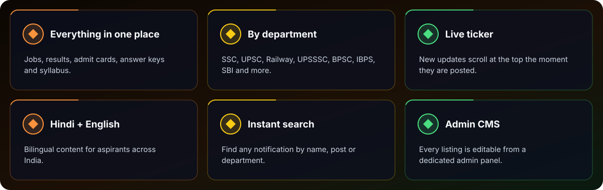
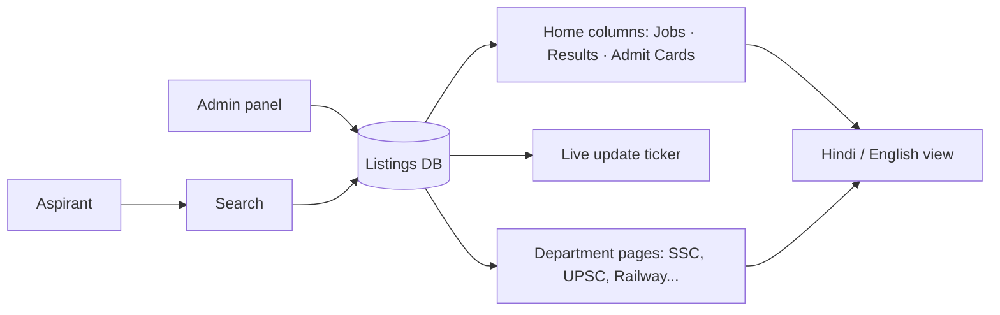

  
  
  
  

  <a href="#-overview"><b>Overview</b></a> &nbsp;•&nbsp;
  <a href="#-features"><b>Features</b></a> &nbsp;•&nbsp;
  <a href="#-tech-stack"><b>Tech</b></a> &nbsp;•&nbsp;
  <a href="#%EF%B8%8F-architecture"><b>Architecture</b></a> &nbsp;•&nbsp;
  <a href="#-source-code"><b>Source</b></a>

## ✨ Overview

**SakariResult.net** is a fast government-jobs portal for Indian aspirants: latest jobs, results, admit cards, answer keys, admissions, syllabus and certificates in clean, scannable columns, with a live ticker of new updates.

Listings are grouped by department (SSC, UPSC, Railway, UPSSSC, BPSC, IBPS, SBI and more), searchable, available in Hindi, and fully editable from the portal’s own admin panel.

  
   🖥️ Live at <a href="https://sakariresult.net"><b>sakariresult.net</b></a>

## 🚀 Features

  

| Feature | What it does |
|:--|:--|
| **Everything in one place** | Jobs, results, admit cards, answer keys and syllabus. |
| **By department** | SSC, UPSC, Railway, UPSSSC, BPSC, IBPS, SBI and more. |
| **Live ticker** | New updates scroll at the top the moment they are posted. |
| **Hindi + English** | Bilingual content for aspirants across India. |
| **Instant search** | Find any notification by name, post or department. |
| **Admin CMS** | Every listing is editable from a dedicated admin panel. |

## 🧰 Tech Stack

## 🏗️ Architecture

## 🔒 Source Code

> [!NOTE]
> This is a **showcase repository**. The production source code of **SakariResult.net** is private and is not published here.
> Want a walkthrough, a similar build for your business, or licensing? **[Get in touch →](https://ajendra.info/contact)**

## 👤 Author

**Ajendra** — Full Stack Developer · Security Researcher · AI Engineer · Startup Advisor

⭐ If you like this project, star the repo — and check out my other work on <a href="https://ajendra.info/projects">ajendra.info/projects</a>.

